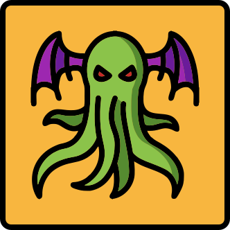
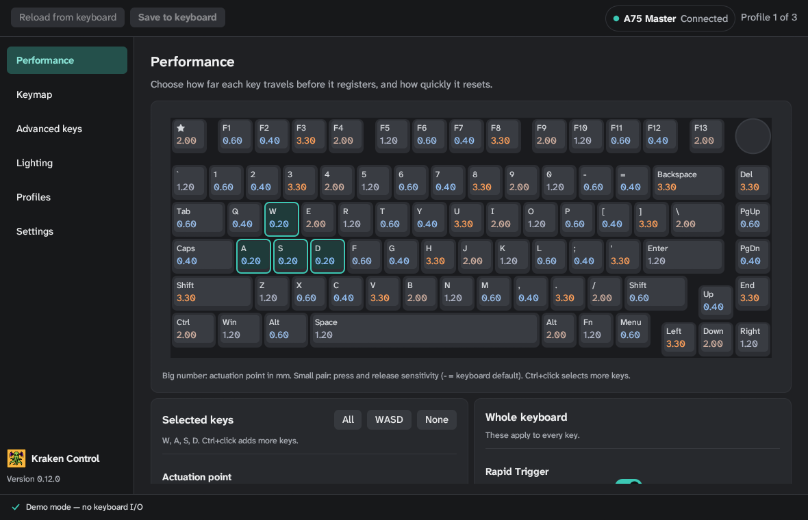
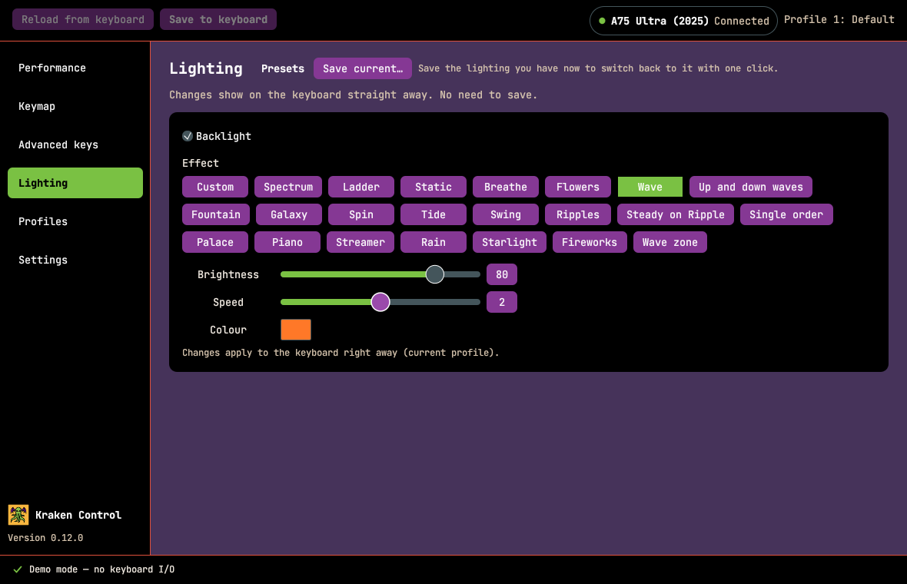

<p align="center">
  
</p>

<h1 align="center">Kraken Control</h1>

A small, native Windows app for DrunkDeer A75 keyboards. It does what the
DrunkDeer web driver does — key travel, Rapid Trigger, remapping, lighting,
profiles — without a browser, .NET or a WebView. The release build is a
single ~4 MB exe.

Kraken Control is an unofficial project. It is not made by or affiliated with
DrunkDeer.



## Supported keyboards

| Keyboard | USB ID | Status |
| --- | --- | --- |
| A75 Master, A75 Ultra (original) | `352D` | Supported |
| A75 Ultra (2025) | `19F5:FB3E` | Supported |
| Other DrunkDeer models | | Detected, not supported yet |

The model is identified from the keyboard's own identity reply, not the USB
product ID.

## Features

**Both keyboards**

- Performance: per-key actuation point and Rapid Trigger press/release
  sensitivity, with multi-select and WASD/All/None shortcuts.
- Keymap: remap every layer from a picker of letters, symbols, F-keys,
  navigation, modifiers, numpad, media and mouse keys. Firmware, reset and
  calibration functions are never offered.
- Lighting: effects, brightness, speed, colour, and per-key custom colours.
  Save lighting presets and switch between them with one click.
- Profiles: switch, add and remove the keyboard's onboard profiles.
- Move to another PC: export every setting (keyboard and app) to one JSON
  file and import it on a fresh install. Imported values are checked before
  anything reaches the keyboard.
- Two themes, Dark Grey (default) and Black-Plumb, both checked for WCAG text
  contrast.
- Portable mode: put a file named `portable` next to the exe and settings
  stay in a `data` folder beside it.

**A75 Master / A75 Ultra (original)**

- Rapid Trigger, Turbo and RT Match (Standard / Competitive / Extreme).
- Last Win and Release Dual-Trigger key pairs.
- Default, Fn and Fn2 layers.
- Profiles saved on the PC: load one, then Save to keyboard.
- Lighting patterns painted across the board.
- Tray agent: switches onboard profiles per app, start with Windows, no
  window or graphics use while it runs.

**A75 Ultra (2025)**

- Rapid Trigger off / on / continuous, top and bottom dead zones.
- Four layers (Main, FN1–FN3) and the knob (press, turn left, turn right).
- Advanced keys: SOCD pairs with priority, Mod Tap, Toggle. Existing DKS,
  Rappy Snappy and One Key Switch keys are listed and can be removed.
- Polling rate, tick rate, anti-shake, Adaptive Stable, Win / Alt+Tab /
  Alt+F4 locks.



## Safety

- Never flashes firmware, never factory-resets, never calibrates.
- Lighting changes apply straight away. Everything else is written only when
  you press **Save to keyboard**, and only what changed.
- Writes are read back from the keyboard and checked wherever the keyboard
  can report them. The original A75's lighting and keymap can't be read
  back, so Kraken keeps its own copy and shows what it last sent.
- Close the DrunkDeer web driver (and any other keyboard app) first. The
  keyboard handles one writer at a time.

To recover a keymap, use **Reset … layer to factory** on the Keymap page, or
the official driver's Remap › Reset all keys.

## Install

There are no prebuilt releases yet. Build from source (below), or build the
portable zip.

Requirements: Windows 10 or 11, 64-bit. The app draws on the CPU by default,
so no particular graphics driver is needed. Settings › Drawing switches to
the graphics card (OpenGL).

## Build

You need Rust (stable, MSVC toolchain) and the Visual Studio Build Tools with
"Desktop development with C++".

```powershell
cargo build --release
.\target\release\kraken-control.exe
```

Portable zip (static C runtime, runs on a PC without the VC++ runtime):

```powershell
.\packaging\package.cmd
# -> dist\KrakenControl-<version>-portable.zip
```

### Development

```powershell
cargo test                                         # protocol + app tests
cargo run -p kraken-control -- --demo              # UI without a keyboard (original A75)
cargo run -p kraken-control -- --demo-gen2         # UI without a keyboard (2025 A75 Ultra)
cargo run -p kraken-control -- --demo --tab=lighting --theme=plumb
```

Other switches: `--agent` (tray mode), `--software` / `--gpu` (renderer for
this run).

On Linux the UI builds and runs in demo mode (used for screenshots); the HID
transport is Windows-only. `cargo check -p kraken-control --features check-win`
type-checks the Win32 code from a non-Windows host.

## Project layout

```
crates/dd-proto   wire protocol for both keyboard generations (pure, no I/O, tested)
app               the Windows app: UI, HID transport, tray agent, software renderer
docs              protocol notes, architecture, project status
packaging         portable zip build
```

Settings live in `%APPDATA%\KrakenControl` (`state.json`, `agent.json`,
`log.txt`), or in `data\` next to the exe in portable mode.

## How the protocol was worked out

The packet formats come from observing DrunkDeer's official web drivers
(beta.drunkdeer-antler.com for the original A75, drunkdeer.keybord.net.cn for
the 2025 A75 Ultra). The notes in `docs/protocol-*.md` describe the protocol
in prose; no driver code is included. The factory keymaps and key-name
tables in `crates/dd-proto/data/` are data extracted from those drivers for
interoperability.

## Credits

- [svumo/DrunkDeer-Control](https://github.com/svumo/DrunkDeer-Control) (MIT),
  the C# profile manager this project started from. Kraken Control is a
  rewrite in Rust; the C# app served as a reference.
- [egui](https://github.com/emilk/egui), [winit](https://github.com/rust-windowing/winit),
  [softbuffer](https://github.com/rust-windowing/softbuffer) and
  [windows-sys](https://github.com/microsoft/windows-rs).
- Fonts: [Atkinson Hyperlegible Next](https://github.com/googlefonts/atkinson-hyperlegible-next)
  and [JetBrains Mono](https://github.com/JetBrains/JetBrainsMono) (SIL OFL 1.1);
  symbol glyphs from Hack (MIT / Bitstream Vera) and emoji-icon-font (MIT).
  Licence texts are in `app/res/fonts/`.

## Licence

MIT. See [LICENSE](LICENSE).
